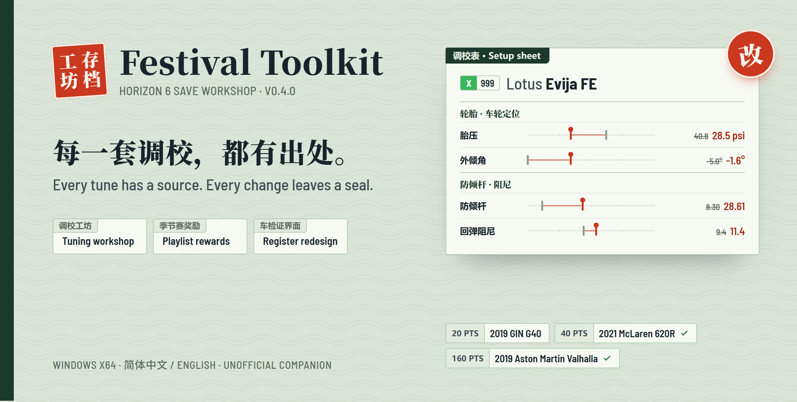
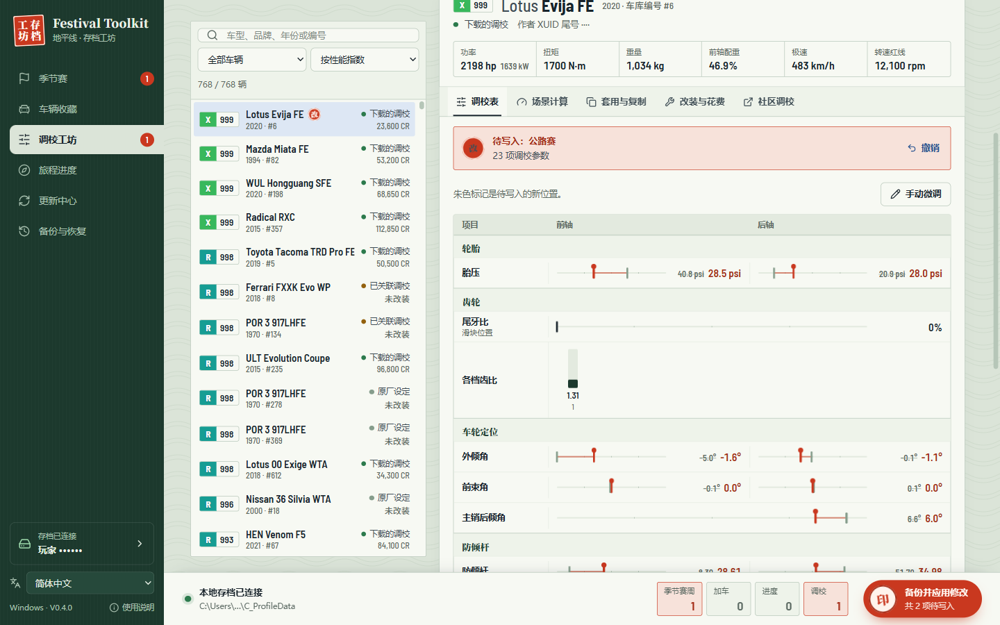
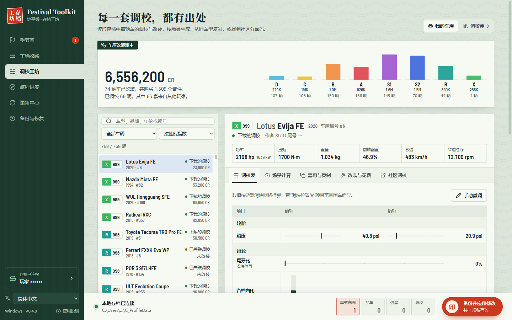
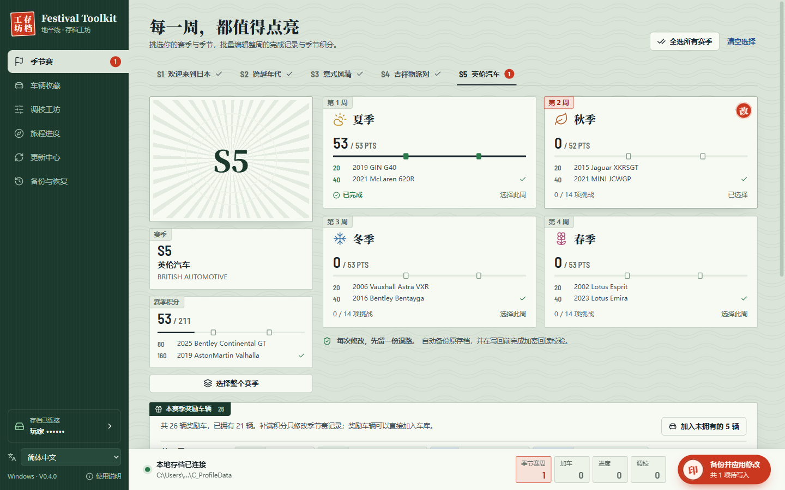
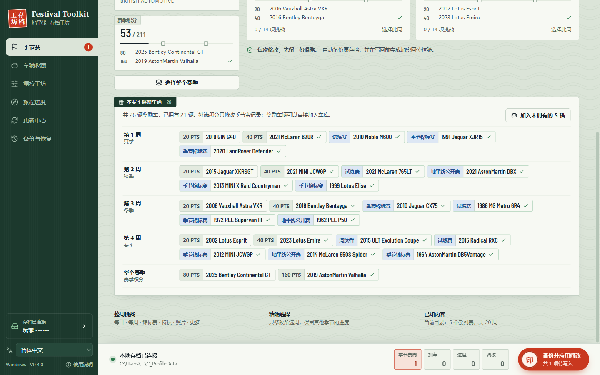
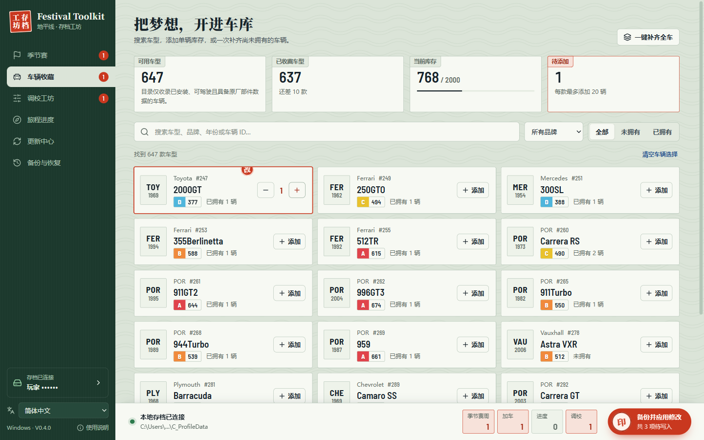
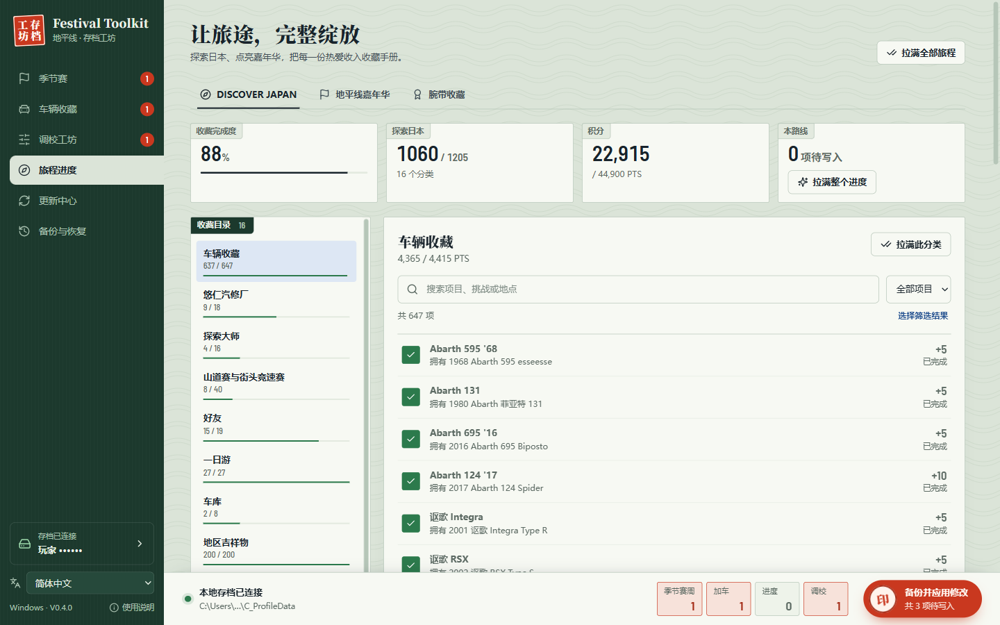

<a href="https://github.com/ChefDavid0815/horizon-festival-toolkit/releases/tag/v0.4.1"></a>

<p align="center"><a href="README.md">English</a> · <b>简体中文</b></p>

<p align="center"><a href="https://github.com/ChefDavid0815/horizon-festival-toolkit/releases/tag/v0.4.1"><b>下载 0.4.1 ↓</b></a> &nbsp; / &nbsp; <a href="docs/RELEASE-0.4.0.md">0.4 说明 ↗</a> &nbsp; / &nbsp; <a href="CHANGELOG.md">版本记录 ↗</a> &nbsp; / &nbsp; <a href="https://chefzc-homepage.vercel.app/gallery.html#project-festival-toolkit">展柜 ↗</a></p>

# Horizon Festival Toolkit · V0.4.1

地平线 6 本地存档工坊。读取你自己存档里的车辆调校与改装、每个部件的实际成交价、季节赛与奖励车辆、收藏手册、腕带和车库。改什么由你决定；工具会先备份、校验，再写回。

| 调校工坊 | 季节赛 | 车辆收藏 | 旅程进度 | 语言 |
| --- | --- | --- | --- | --- |
| 调校表、场景计算、改装复制、CR 账本 | 随游戏更新、奖励车辆 | 647 款车型，加车或补齐 | 38 类、2,833 项、七色腕带 | 简体中文 / English / 跟随系统 |

## 下载

**[Windows x64 · 0.4.1](https://github.com/ChefDavid0815/horizon-festival-toolkit/releases/tag/v0.4.1)**：安装版、免安装版、SHA-256 校验和验证报告。

- [Horizon-Festival-Toolkit-0.4.1-Setup.exe](https://github.com/ChefDavid0815/horizon-festival-toolkit/releases/download/v0.4.1/Horizon-Festival-Toolkit-0.4.1-Setup.exe)
- [Horizon-Festival-Toolkit-0.4.1-Portable.exe](https://github.com/ChefDavid0815/horizon-festival-toolkit/releases/download/v0.4.1/Horizon-Festival-Toolkit-0.4.1-Portable.exe)
- [SHA256SUMS-0.4.1.txt](https://github.com/ChefDavid0815/horizon-festival-toolkit/releases/download/v0.4.1/SHA256SUMS-0.4.1.txt)

安装包未签名，Windows SmartScreen 可能会要求确认。连接存档前请先退出游戏。

**0.4.1** 修复了进度较少、或含有 10 月 5 日更新新增收藏项目的存档中，季节赛与收藏手册停止编辑的问题；内置第 6 季 Horizon Meets；新增“导出诊断信息”。详见 [0.4.1 说明](docs/RELEASE-0.4.1.md)。

## 调校工坊



- **调校表**：读取存档里每辆车的调校。以下项目按游戏滑块网格换算成实际单位，范围是从已保存调校的滑块步进反推得出的：
  - 胎压 15–55 psi、各档齿比 0.48–6.00；
  - 外倾与前束 ±5°、主销后倾 1–7°；
  - 防倾杆 1–65、回弹与压缩阻尼 1–20；
  - 刹车平衡与力度、差速器锁止。

  弹簧、车身高度、下压力和尾牙比的范围因车而异，以滑块位置显示。
- **调校来源**：原厂设定、自己的调校、本地调校，或从其他玩家下载的调校（显示作者 XUID 尾号）。
- **场景计算**：公路、街头、泥地、越野、漂移、直线加速、雪地、极速八种场景，可微调转向特性与悬挂软硬。根据前后配重和你选择的驱动形式计算，保留原有齿比。结果只能作为起点，不是实测调校。
- **同车型复制**：可以只复制调校，也可以连同整套改装一起复制。改装花费按来源车辆的实际成交价计算，写入前会显示性能等级的变化。也可以一键恢复原厂调校。
- **车库改装账本**：精确显示每辆车和 D 到 X 每个等级的改装花费，点击等级即可筛选车辆。不修改你的 CR 余额。
- **调校库**：保存在本机，可导入导出调校包，分享给其他工具用户。
- **社区调校**：按车型在 CODMunity 公开页面查找分享码。分享码需要在游戏“升级与调校 → 寻找调校设置”中下载；下载后重新连接存档，就能收藏或复制到同车型其他车辆。

<details><summary><b>车库改装账本</b></summary>



</details>

## 季节赛



- **随游戏更新**：未设置目录时自动寻找 Steam 或 Xbox 安装目录；运行期间每分钟检查游戏资源。游戏更新后，新的系列赛、周、活动和奖励会自动读入；游戏还在下载时会静默等待。
- **奖励车辆**：每周的积分奖励车、整个赛季的总积分奖励车，以及各项赛事的奖励车，全部来自游戏资源。积分条上的刻度达到门槛后变绿，已拥有的车辆带对勾。“加入未拥有的奖励车”会把缺少的车放进加车列表。
- 可以选择一周、整个赛季或全部，完成记录和积分会一起写入。新系列赛需要先在游戏里打开过一次，退出后重新连接存档。

<details><summary><b>整个赛季的奖励车辆</b></summary>



</details>

## 车辆收藏、收藏手册与腕带

- 按车型、品牌、年份或 ID 搜索 647 款车型，支持常用中文品牌名。每款可加 1–20 辆，也可以一次补齐所有缺失车型。
- Discover Japan 与地平线嘉年华收藏手册共 38 个分类、2,833 个项目，可选单项、分类、整条路线或全部，完成记录与积分一起更新。
- 七色腕带持有记录，可单条补齐，也可以一次补齐所有缺失颜色。

<details><summary><b>车辆收藏与旅程进度</b></summary>





</details>

## 修改如何写入

浏览时不会写入任何内容。所有选择，包括季节周、车辆、收藏项目和调校，都会先进入待写入列表并盖上印章。点击“备份并应用修改”后：

1. 保存原文件和 `_SCopy`；
2. 在内存中生成修改后的存档，逐字节核对：没有选中的车辆、字段、数据表和存档状态块都保持不变；
3. 重新加密后再解密回读，进行比对；
4. 写回两个文件。

“备份与恢复”可以回到任何历史版本，恢复前也会再留一份快照。

## 内容更新

季节赛与奖励从 `media/ObjectModelGame.zip` 解析，车辆原厂配置来自 `media/Stripped/gamedbRC.slt`。新的加密车辆数据库需要启用在线解密或导入内容包。内容同步只读取游戏资源，不读取也不上传玩家存档。可以导入、导出独立 JSON 内容包，见 [内容包格式](docs/CONTENT-PACKS.md)。

## 从源码运行

```powershell
npm ci
npm run build
npm start
```

按 [tools/README.md](tools/README.md) 安装并核验上游工具后，运行 `npm run package` 打包。`npm run dev` 只提供界面开发环境，存档功能依赖 Electron。

## 验证与边界

- `npm test` 共 49 项，覆盖存档、车库、调校、调校库、社区解析、奖励、自动同步、目录、备份与语言偏好。
- `npm run verify:desktop` 与 `verify:journey` 在真实应用中用私人存档副本完整跑通，包括调校与改装写入。私人样本不会公开。
- 详见 [验证记录](docs/VERIFICATION.md) 和发布页的 `VERIFICATION-0.4.1.json`。

其他说明：

- 加密**玩家存档**通过随附的 [ForzaCryptoTool](https://github.com/DVS-code/Forza-Crypto-Tool) 处理，会把所选存档上传到 `forzamods.dev`，连接弹窗会说明。启用车辆数据库在线解密时，会发送**游戏资源** `gamedbRC.slt`。
- 社区调校只在打开对应页面时读取 codmunity.gg 公开页面。
- 尚未验证：写入调校后的游戏内读档与驾驶、游戏如何重新计算复制的改装、奖励发放、线上同步与未来存档格式。
- 奖励读取已用 2.440.853.0 版游戏资源核对，内置的第 6 季数据来自 2026 年 10 月 16 日的游戏资源同步；安装目录识别已在 Steam 路径上测试，但尚未在重新安装好的游戏上跑过完整的自动同步。
- 加车不会授予付费内容的所有权。

[版本记录](CHANGELOG.md) · [第三方来源](THIRD_PARTY.md) · [设计说明](DESIGN.md)

个人非官方项目，与 Microsoft、Xbox、Playground Games 无隶属关系。游戏内容与商标归其权利人所有。
